<h3><code>aditya@github ~ $ whoami</code></h3>

 
 

<h3><code>aditya@github ~ $ ./contributions.sh</code></h3>

 
 

<h3><code>aditya@github ~ $ ./tech_arsenal.sh</code></h3>

 
 

<h3><code>aditya@github ~ $ ./stats.sh</code></h3>

